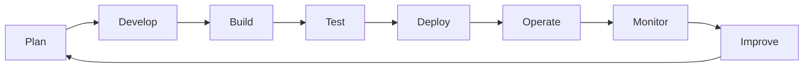

# 🚀 What Is DevOps?

> [!IMPORTANT]
> DevOps is **not a tool**.
>
> DevOps is **not Docker**.
>
> DevOps is **not Kubernetes**.
>
> DevOps is **not AWS**.
>
> DevOps is a culture, a mindset, and a way of delivering value to customers.

---

## 🎯 Learning Objectives

By the end of this lesson you should understand:

- What DevOps is
- Why DevOps exists
- The problems DevOps solves
- How DevOps delivers value
- The Restaurant Analogy
- The Airport Analogy
- The Solutionist perspective

---

# 🤔 Why Should You Care?

Almost every modern company depends on technology.

Examples include:

- 🏦 Banks
- ✈️ Airlines
- 🛒 Amazon
- 🎬 Netflix
- 🏥 Hospitals
- 🏛️ Government Services

The challenge is not building technology.

The challenge is delivering technology:

✅ Quickly

✅ Safely

✅ Reliably

✅ Consistently

This is where DevOps comes in.

---

# 📖 Simple Definition

DevOps is a way of working that brings together:

- 👨‍💻 Development Teams
- ⚙️ Operations Teams
- 🔒 Security Teams
- 📈 Business Teams

to deliver software faster, safer, and more reliably.

The goal is simple:

## ✅ Deliver value to customers

---

# 🚨 Why DevOps Exists

Before DevOps, development and operations teams often worked separately.

---

## 👨‍💻 Developers

Focused on:

- Writing code
- Building features
- Fixing bugs

Success looked like:

> "The application works on my machine."

---

## ⚙️ Operations Teams

Focused on:

- Stability
- Security
- Infrastructure
- Keeping services online

Success looked like:

> "Nothing is broken."

---

## ❌ The Problem

Developers wanted constant change.

Operations wanted stability.

The result:

- Slow deployments
- Failed releases
- Finger-pointing
- Frustrated customers

```text
Developer
    ↓
Builds Software
    ↓
Throws Software To Operations
    ↓
Deployment Fails
    ↓
Blame Begins
```

This was a people and process problem.

DevOps was created to solve it.

---

# ✅ The DevOps Solution

DevOps encourages collaboration.

Everyone works towards the same goal.

```text
Developers
      +
Operations
      +
Security
      +
Business
      ↓
Customer Value
```

Instead of working in silos, teams share responsibility.

---

## 🔄 The DevOps Lifecycle



DevOps is a continuous cycle of improvement.

---

# 🍔 Restaurant Analogy

One of the easiest ways to understand DevOps is to imagine a restaurant.

---

## 😊 Customers

Customers enter the restaurant and order food.

The customer does **not** care:

- Which chef cooked it
- Which oven was used
- Which waiter delivered it

The customer only cares that:

✅ The food arrives

✅ The food is correct

✅ The food tastes good

Software users think exactly the same way.

They simply want the application to work.

---

## 👨‍🍳 Developers = Chefs

Developers create the product.

Their responsibilities include:

- Building new features
- Improving existing features
- Fixing problems

Just like chefs create meals.

---

## 🧑‍💼 Operations = Restaurant Staff

Operations teams ensure everything runs smoothly.

Responsibilities include:

- Servers
- Infrastructure
- Networks
- Monitoring

Just like restaurant staff manage:

- Equipment
- Deliveries
- Inventory
- Customer service

---

## 🚨 Before DevOps

Imagine chefs and restaurant staff never communicate.

A chef creates a new menu item.

Unfortunately:

❌ Ingredients were not ordered

❌ Waiters were not informed

❌ Menus were not updated

The restaurant becomes chaotic.

This is how many traditional IT organisations operated.

---

## ✅ With DevOps

Everyone works together.


The focus becomes delivering value rather than assigning blame.

---

# ✈️ Airport Analogy

DevOps can also be understood through an airport.

Most passengers only see the aeroplane.

Many teams are working behind the scenes.

---

## 🛩️ Developers = Aircraft Designers

Aircraft designers continuously improve:

- Safety
- Reliability
- Performance

Developers continuously improve software.

---

## 🧰 Operations = Ground Crew

Ground crews:

- Refuel aircraft
- Perform inspections
- Prepare flights

Operations teams:

- Maintain infrastructure
- Deploy applications
- Ensure stability

---

## 📊 Monitoring = Air Traffic Control

Air traffic controllers constantly monitor:

- Aircraft
- Weather
- Runways
- Potential risks

DevOps engineers monitor:

- Applications
- Servers
- Databases
- Networks

The goal is simple:

## ✅ Detect problems before customers notice them

---

## 🚀 Deployment = Take-Off

An aircraft sitting on a runway creates no value.

Software sitting on a developer's laptop creates no value.

Value is only created when:

```text
Software reaches users
```

Just like:

```text
Passengers reach destinations
```

---

# ⚙️ Automation

A core DevOps principle is automation.

Without automation:

```text
Build
Test
Deploy
Monitor

Manually
Every Time
```

This creates:

- Human error
- Delays
- Inconsistency

---

With automation:

```text
Build
   ↓
Test
   ↓
Deploy
   ↓
Monitor
```

The process becomes:

✅ Faster

✅ More Reliable

✅ Repeatable

✅ Scalable

---

> [!TIP]
> Great engineers automate repetitive work so they can spend more time solving problems.

---

# 🔄 Continuous Improvement

DevOps is not a destination.

It is an ongoing process.

Teams continuously ask:

- What can be improved?
- What can be automated?
- What can be simplified?
- What can be made more reliable?

Every improvement makes future deployments safer and faster.

---

# 🚨 Common DevOps Misconceptions

### Myth 1

> DevOps means learning Docker.

❌ Incorrect

Docker is only a tool.

---

### Myth 2

> DevOps is just operations.

❌ Incorrect

DevOps includes people, processes, collaboration, automation, and culture.

---

### Myth 3

> DevOps is only for large companies.

❌ Incorrect

Any team that delivers software can benefit from DevOps practices.

---

# 🧠 Solutionist Thinking

Most beginners see:

```text
Docker
AWS
Linux
Kubernetes
```

A DevOps Engineer sees:

```text
Systems
```

A Senior Engineer sees:

```text
Platforms
Processes
Automation
Reliability
```

A Solutionist sees:

```text
Customers
Problems
Value
Risks
Bottlenecks
Improvements
```

---

> [!IMPORTANT]
> Never ask:
>
> "What tool should I learn next?"
>
> Ask:
>
> "What problem am I trying to solve?"

---

# 💡 Key Takeaways

✅ DevOps is a culture

✅ DevOps improves collaboration

✅ DevOps uses automation

✅ DevOps focuses on customer value

✅ DevOps improves reliability

✅ DevOps is not a tool

✅ DevOps is about delivering software safely, reliably, and repeatedly

---

# 🏆 Solutionist Wisdom

> A beginner sees tools.
>
> An engineer sees systems.
>
> An architect sees platforms.
>
> A Solutionist sees how value moves from an idea to a customer.
>
> Technology changes.
>
> Tools change.
>
> Problem-solving and systems thinking remain valuable forever.
